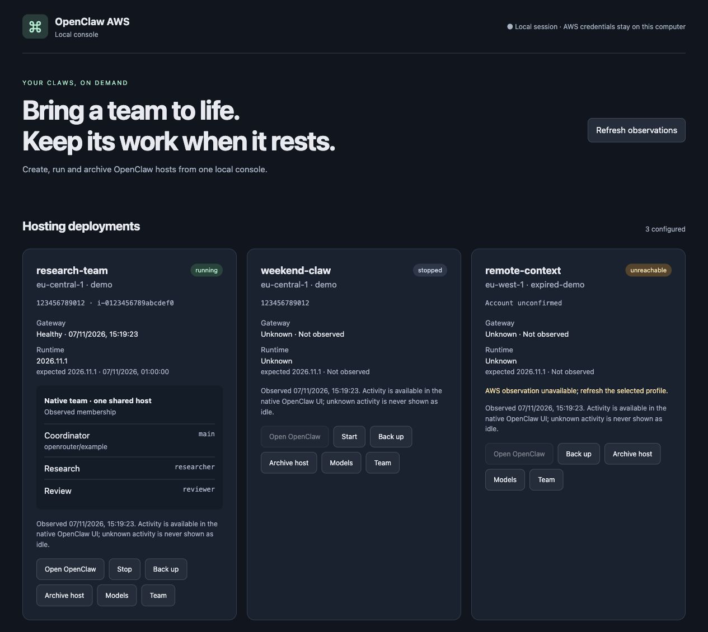
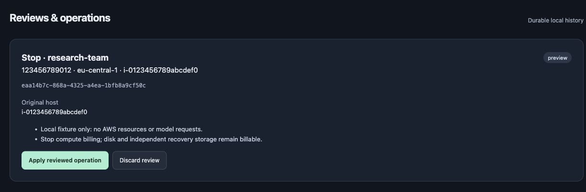

# openclaw-aws

[](https://github.com/salza80/openclaw-aws/actions/workflows/ci.yml) [](https://github.com/salza80/openclaw-aws/actions/workflows/ci.yml)

Create OpenClaw hosts on AWS, run teams, and save their work before removing idle infrastructure. Use simple CLI commands or an optional local browser console. OpenRouter and Amazon Bedrock are supported.

## Install and create a claw

These instructions describe the current source. **The npm release containing these features is pending**; use a source build for now.

Requirements: Node.js 22.13+ (24.22.2 recommended), npm, an authenticated AWS CLI v2, and the AWS Session Manager plugin for interactive connections and dashboards. Your AWS identity needs permission to provision EC2, IAM, SSM and CloudFormation resources; recovery also uses S3 and Secrets Manager.

```bash
git clone https://github.com/salza80/openclaw-aws.git
cd openclaw-aws
nvm install && nvm use  # Or supply the Node version in .nvmrc
npm ci --ignore-scripts --no-audit --no-fund
npm run build
npm link --ignore-scripts --no-audit --no-fund

# Keep each project's local configuration in its own working directory.
mkdir ../my-claws && cd ../my-claws
read -rs OPENROUTER_API_KEY  # Enter your key privately, then press Return
export OPENROUTER_API_KEY
openclaw-aws create personal --provider openrouter --region eu-central-1 \
  --instance-type t3a.small --model openrouter/openai/gpt-4.1-nano
openclaw-aws status --name personal --runtime
openclaw-aws ui
```

`create` reviews provisioning and any required CDK bootstrap before approval. It uses the region's default VPC, an encrypted 30 GiB root disk and SSM access without public SSH or Gateway ports. Add `--profile work` to select an AWS profile. Named configurations live under `.openclaw-aws` in your working directory.

Fresh hosts use Ubuntu 24.04, OpenClaw 2026.11.1 and Node.js 24.22.2. A small startup launcher retrieves the installation through CloudFormation Init; fresh creation waits for authenticated Gateway health. Supported instances are x86_64 with at least 2 GiB RAM; small hosts receive managed swap. See [EC2 sizing](docs/ec2-sizing.md). Failed provisioning retains resources for inspection: check status and clean up deliberately to stop charges.

## Local console

The console groups native agents beneath their shared EC2 host and offers reviewed lifecycle, recovery, team and model operations. **Open OpenClaw** opens the native UI through SSM for conversations and agent activity.



_Actual application screenshots with synthetic demo data; no live AWS operations or model calls are shown._



The console runs on loopback and keeps AWS credentials on your computer. See [pairing, reviews and interrupted operations](docs/local-console.md).

## Everyday commands

```bash
openclaw-aws list
openclaw-aws status --all
openclaw-aws stop --name personal
openclaw-aws start --name personal
openclaw-aws dashboard --name personal
openclaw-aws connect --name personal
openclaw-aws --help
```

Use `--name` to choose a deployment, or `use <name>` to change the default. `init` followed by `deploy` is also available for interactive configuration.

| Workflow | What it does                                                                                           | Guide                                                           |
| -------- | ------------------------------------------------------------------------------------------------------ | --------------------------------------------------------------- |
| Teams    | Multiple native agents with separate workspaces, roles and explicit communication policies on one host | [Teams](docs/teams.md)                                          |
| Models   | Change persistent defaults or an agent's model without rebuilding its instance                         | [Model management](docs/model-management.md)                    |
| Bedrock  | Optional instance-role inference billed through AWS; OpenRouter remains available                      | [Provider setup](docs/bedrock-provider-workflow.md)             |
| Backup   | Verify a complete installation in an independent encrypted recovery vault                              | [Backup and restore](docs/native-backup-transport.md)           |
| Archive  | Back up, verify, then delete the shared host and its owned source resources                            | [Archive](docs/archiving.md)                                    |
| Restore  | Recover saved identity and history onto a new host, then explicitly activate                           | [Recovery](docs/native-backup-transport.md#clean-client-helper) |
| Clone    | Copy supported knowledge and policy into a fresh identity with explicit credentials                    | [Independent copies](docs/independent-clones.md)                |

Team agents share the host's OS and AWS role; they are not isolated machines. OpenClaw owns coordination, conversations and schedules. This tool manages their AWS lifecycle.

## Save work, remove compute, return later

```bash
# Create an independent vault; retain the printed vault URI and recovery-key reference.
openclaw-aws vault create primary --region eu-central-1

# Use that vault's actual URI. Archive includes a verified backup and host teardown.
openclaw-aws archive --name personal --vault s3://YOUR_BUCKET/YOUR_PREFIX

# A clean client can discover backups without the original host or local config.
openclaw-aws backup list --vault s3://YOUR_BUCKET/YOUR_PREFIX --region eu-central-1
openclaw-aws restore --from BACKUP_UUID --vault s3://YOUR_BUCKET/YOUR_PREFIX \
  --region eu-central-1 --name personal-again
openclaw-aws restore activate --operation-id RESTORE_OPERATION_UUID
```

**Stop** retains the disk and other billable resources. **Archive** removes owned hosting resources while retaining recovery storage and its key, which can still incur charges. **Destroy** deletes instance data without creating a backup. Keep the vault URI and independent recovery-key reference before deleting local configuration. Restore and clone stage inactive hosts for deliberate activation; follow the linked guides before reconnecting integrations or resuming historical work.

Full integrated AWS acceptance remains tracked in [issue #28](https://github.com/salza80/openclaw-aws/issues/28). Local tests and demo screenshots do not establish that every live workflow has passed. This package targets fresh installations; it does not migrate older deployments or upgrade an existing host when the CLI is updated.

## Development

From the repository, use the Node version in `.nvmrc` and run `npm ci --ignore-scripts --no-audit --no-fund`, then:

```bash
npm run build
npm run typecheck
npm run lint
npm run format:check
npm test
```

[Repository guidance](AGENTS.md) · [OpenClaw documentation](https://docs.openclaw.ai/) · [MIT license](LICENSE)
